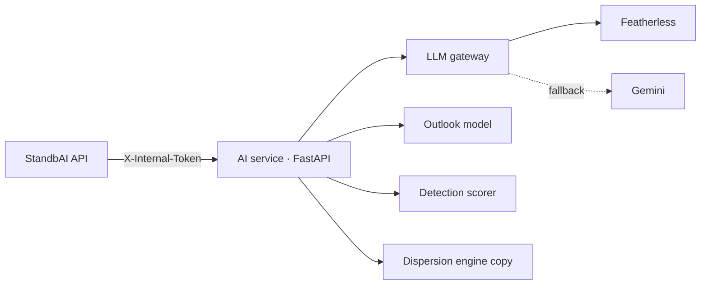

# StandbAI: AI Service

**The AI layer of StandbAI**, a forecast-and-prepare platform for wildfire smoke and volcanic ash in Indonesia. It answers residents' questions in plain words, forecasts fire activity beyond the 3-day plume window, and summarises past events with citations. Every answer is grounded in data, and every model is compared with a simple baseline.

*ForgeHacks Online 2026 · AI + Climate track*

| | |
|---|---|
| Backend API (the only caller) | [BE-FORGEHACK-2026](https://github.com/ITHACKITS/BE-FORGEHACK-2026) |
| Web app | [FE-FORGEHACK-2026](https://github.com/ITHACKITS/FE-FORGEHACK-2026) |

---

## What the AI does, and why

| Capability | Why it matters | How |
|---|---|---|
| **Ask StandbAI** (web chat and Telegram bot; stretch goal) | Residents ask "Will smoke reach Jambi this week?" instead of learning an app | Two small LLM steps around deterministic tools: `interpret` turns the message into a structured intent; the backend fetches facts and builds links; `respond` writes ≤3 sentences using only those facts. Numbers and links never come from the model. |
| **Fire-activity outlook** (next 7 days; monthly climatology for "next month") | The plume engine sees 72 hours ahead; families also plan weeks ahead | NASA FIRMS VIIRS 2020–2025 aggregated to 0.25° cells × weeks. The first version is a **climatology baseline** (how often each cell had fires in the same week and month of 2020–23). A gradient-boosted model, trained on 2020–23 and tested on 2025, replaces it only if it beats the climatology and persistence baselines |
| **History summaries** (Merapi 2010, 2019 haze) | "What happened last time, and what did people need?" | Batch LLM summaries of news headlines and Wikipedia with numbered citations, reviewed by a person |
| **Emergency advisory** | Briefing text for schools, health workers and the public after a simulation | Deterministic expert template, optionally rephrased by the LLM |
| **FIRMS detection scorer** | Scores satellite fire detections | RandomForest on detection features (see limits below) |

### LLM providers
- **Primary: Featherless AI** (a ForgeHacks sponsor). It serves open models through an OpenAI-compatible API.
- **Fallback: Google Gemini**, through its OpenAI-compatible endpoint.
- **Last resort: a deterministic template reply.**

Each answer reports which `engine` produced it. The model ids and the evaluation table are added here after the evaluation run (PRD ticket AI-05).

## Status

The **Status** column is updated at submission time to what actually runs.

| Feature | Status |
|---|---|
| Dispersion simulation endpoint (shared engine with the backend) | Working (`pytest`: 9 passed, 2026-10-10) |
| FIRMS detection scorer `/api/v1/fire/predict`, `/predict-batch` | Working, being reframed (see limits) |
| Emergency advisory `/api/v1/advisory` | Broken today; fix planned |
| LLM gateway (Featherless → Gemini → template) | Planned |
| Fire-activity outlook: climatology baseline `/api/v1/outlook/point` + model card | Planned (first priority) |
| Fire-activity outlook: ML model | Planned (stretch; roadmap if not ready) |
| Chat interpret/respond + evaluation set | Stretch (only if the items above are done) |
| History summaries | Stretch |

## Architecture

## Endpoints

| Method | Path | Purpose |
|---|---|---|
| GET | `/`, `/health` | Service info and status |
| POST | `/api/v1/simulate` | Run a dispersion simulation (copy of the backend engine) |
| POST | `/api/v1/advisory` | Emergency advisory text |
| POST | `/api/v1/validate` | Event validation |
| POST | `/api/v1/fire/predict`, `/api/v1/fire/predict-batch` | Score FIRMS detections (needs brightness, FRP or confidence) |
| GET | `/api/v1/outlook/point`, `/api/v1/outlook/grid` | Fire-activity outlook (planned) |
| POST | `/api/v1/chat/interpret`, `/api/v1/chat/respond` | Chat language layer (planned) |
| POST | `/api/v1/history/summarize` | Past-event summaries (planned) |

Interactive docs at `/docs` when running.

## Models and their limits

- **FIRMS detection scorer** (`app/models/fire_predictor_global.pkl`):
  - Its negatives were *synthetic* random points with zero fire power, so it separates "looks like a satellite detection" from "random cold point". Its in-sample accuracy says nothing about forecasting fires.
  - It **isn't a location risk forecast**. Sent only a latitude and longitude, today's code returns "low" even inside active fire areas; this is being changed to return "not available".
  - Use the outlook for risk.
- **Fire-activity outlook:** the model card (`docs/MODEL_CARD_outlook.md`) will hold the data, the time-based split, the metrics versus baselines and the thresholds. If the model doesn't beat the climatology baseline, we ship the climatology baseline and say so.
- **LLM answers:**
  - limited to facts supplied by the backend;
  - they can still phrase things imperfectly;
  - they're never an official warning.

## Documentation

| File | Purpose |
|---|---|
| [`SETUP.md`](SETUP.md) | Install, run, test, train, deploy |
| [`PRD.md`](PRD.md) | Requirements, prompts, contracts and the task board |
| [`MEMORY.md`](MEMORY.md) | Context, conventions and decision log |
| [`AGENTS.md`](AGENTS.md) | Rules for coding agents and contributors |

## Data and credits

- NASA FIRMS (VIIRS S-NPP) fire detections, from the 2020–2025 Kaggle export.
- Open-Meteo weather (rainfall features).
- News headlines and Wikipedia for history summaries: we link to the original publishers and don't store article text.
- Featherless AI and Google Gemini for language generation.

## Team

| Person | Role |
|---|---|
| Arkan Zahir | AI |
| Hikari Reiziq | Backend API and platform (deploys this service) |
| Arya Bisma | Backend engine and data |
| Ziddan Habibie | Frontend |
